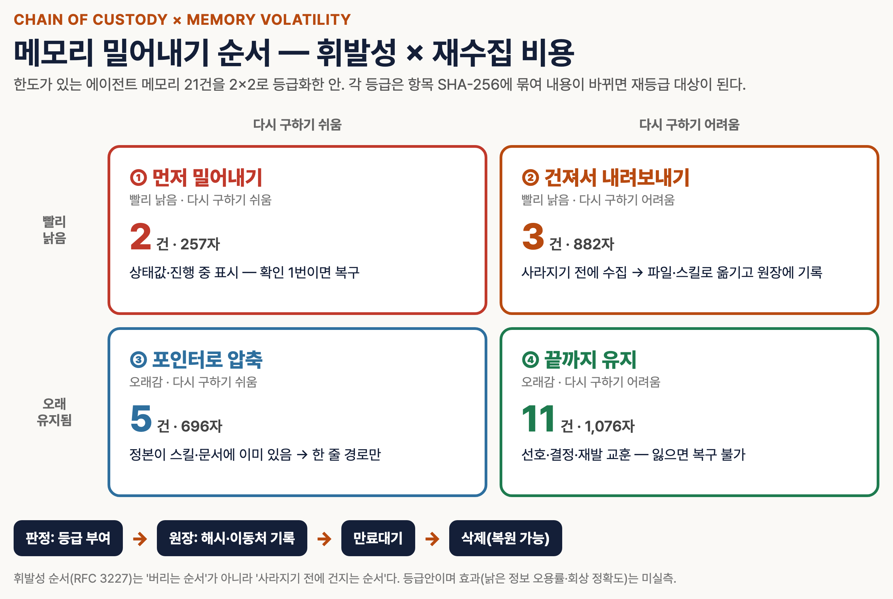
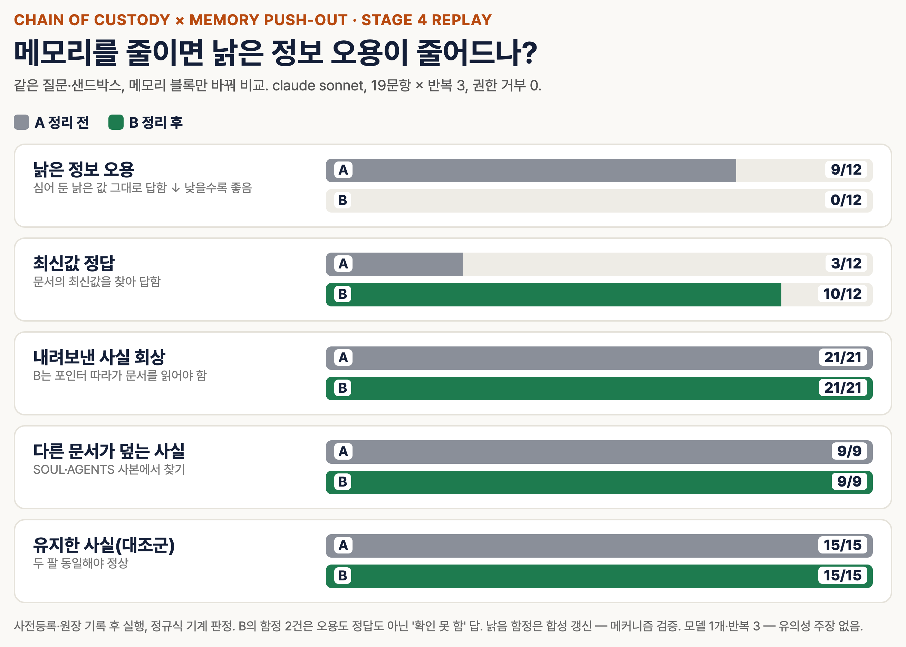
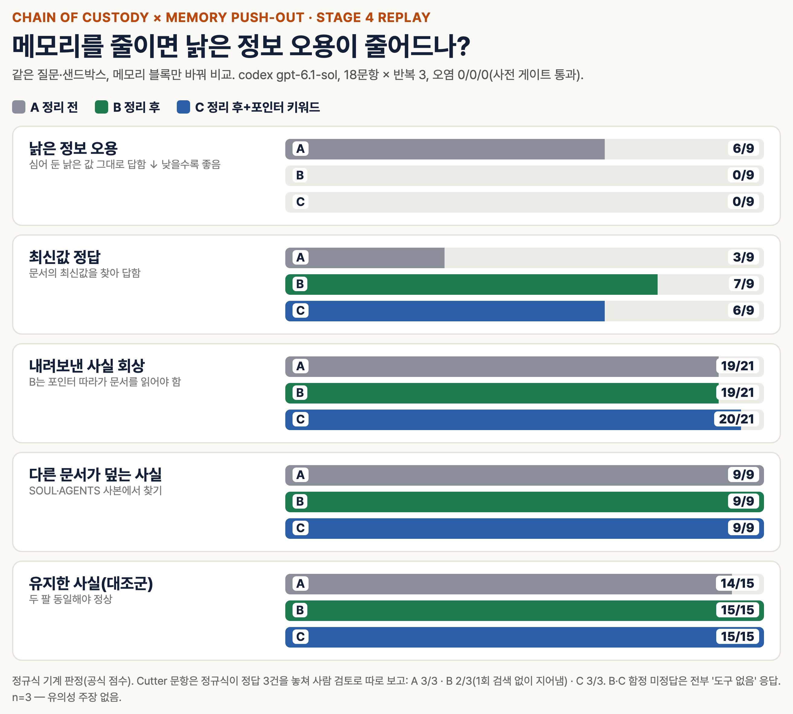

# Chain of Custody

기존 artifact를 새 포맷으로 복제하지 않고 SHA-256 digest와 portable locator로 색인한다. 모델·벤더와 무관한 공통 event chain을 append-only JSONL로 남기고 검증한다. 외부 패키지는 사용하지 않는다.

## 언제 쓰나

- 원천 → 판정 → 결정 → 적용 → 검증의 계보와 위변조 탐지가 필요할 때
- Claude/Claude Code, Codex/OpenAI, Hermes, Open Claw, Jev, 규칙엔진, 사람 검토를 같은 원장에 기록할 때
- baseline과 candidate가 같은 Pareto cohort인지 비교 전에 fail-closed로 확인할 때
- 쓰지 않는 경우: artifact 본문을 보관·변환하는 저장소, 전자서명·공증, 접근제어 시스템이 필요할 때

## 입력 계약

- artifact는 `artifact_id`, `digest.algorithm=sha256`, `digest.value`, `locator`만 기록한다.
- locator는 `{"scheme":"repo","path":"relative/posix/path"}` 형식이다. 절대경로, `..`, 역슬래시는 거부한다.
- actor 공통 필드는 `adapter`, `provider`, `principal_type`, `model`, `runtime`이다. `adapter`는 실행기·오케스트레이터이고 `provider`는 실제 모델/판정 제공자라 서로 다를 수 있다.
- adapter는 `anthropic`, `openai`, `hermes`, `open-claw`, `jev`, `rules-engine`, `human` 입력을 정본 ID로 정규화한다. unknown adapter는 기록과 검증 모두 실패한다.
- event type은 `source`, `judgment`, `decision`, `application`, `verification`이다.
- 모든 event는 artifact를 1개 이상 참조해야 한다. 증거 없는 event는 기록도 검증도 실패한다.
- append는 artifact digest를 실제 파일과 대조한 **뒤에만** 원장에 쓴다. 틀린 digest는 원장을 건드리지 않고 거부된다.
- `metadata`의 `api_key`, token, password, authorization, cookie, session 및 메시징 식별자는 저장 전에 `[REDACTED]`로 바꾼다. metadata 밖(actor·artifact·비교 계약 등)에 비밀값 형태가 있으면 가리지 않고 **기록을 거부**한다.

## 실행

Hermes `terminal`에서 이 스킬 디렉터리를 `workdir`로 지정해 실행한다.

1. 기존 artifact를 색인한다.

   `python3 scripts/chain_of_custody.py artifact --root . --path fixtures/result.json --id result-v1`

2. 출력된 reference를 event JSON의 `artifacts` 배열에 넣는다. artifact 원문은 옮기거나 복제하지 않는다.

3. event를 append한다. 기존 ledger가 있으면 현재 receipt, chain, artifact를 먼저 전수검증한다.

   `python3 scripts/chain_of_custody.py append --ledger custody/events.jsonl --receipt custody/receipt.json --root . --event event.json`

4. 소비 직전에 다시 검증한다.

   `python3 scripts/chain_of_custody.py verify --ledger custody/events.jsonl --receipt custody/receipt.json --root .`

5. Pareto 입력은 custody PASS 뒤에 비교 계약도 확인한다.

   `python3 scripts/chain_of_custody.py compare --baseline baseline-contract.json --candidate candidate-contract.json`

## 비교 계약

baseline과 candidate의 다음 값이 모두 같아야 `COMPARABLE`이다.

- `cohort_id`, `cohort_sha256`, `n_units`
- `metric.name`, `metric.direction`, `metric.unit`
- `code_revision`
- `adapter`, `provider`, `model`, `runtime` — `provider`·`runtime`도 양쪽에 명시해야 한다. 둘 다 빠진 것은 "같은 조건"이 아니라 "모르는 조건"이다.

하나라도 누락·형식오류·불일치이면 `INCOMPARABLE`로 중단한다. 점수가 같다는 이유로 우회하지 않는다.

## 밀어내기(supersession) 결정

비슷한 스킬·하네스가 경쟁해 한쪽이 다른 쪽을 밀어낼 때는 `decision` event에 `supersession`을 넣는다.

```json
{"winner": "skill-b", "loser": "skill-a", "retained_strengths": ["task-7"],
 "baseline": {"...": "비교 계약"}, "candidate": {"...": "비교 계약"}}
```

- `decision` 이외 event에 넣으면 실패한다.
- `baseline`·`candidate`가 위 비교 계약에서 `COMPARABLE`이 아니면 기록 자체가 실패한다. 공정하지 않은 경쟁의 승패는 원장에 남지 않는다.
- `retained_strengths`(밀려난 쪽이 더 잘한 과제)는 필수다. 빈 목록은 "확인했고 없음"이라는 명시이며 생략과 다르다. 승자독식 방지 장치다.
- 밀려난 스킬은 삭제하지 않는다. 비활성화하고 이 event를 근거로 되돌릴 수 있게 둔다.
- custody는 승패 판정이 옳은지를 보증하지 않는다. 같은 계약 아래에서 내려진 결정이라는 계보만 증명한다.

## 확장 계획: 메모리 밀어내기 [계획·미실측]



한도가 있는 에이전트 메모리를 휘발성(빨리 낡음/오래 유지) × 재수집 비용(쉬움/어려움) 2×2로 등급화하고, 밀어내기 전 항목 해시와 이동처를 원장에 남긴 뒤 만료대기를 거쳐 삭제한다. 포렌식 휘발성 순서(RFC 3227)는 "사라지기 전에 건지는 순서"로 차용한다. 그림 수치는 한 운영 환경의 등급안이며 효과는 아직 재지 않았다.

## 검증 기준

- receipt의 event count, head hash, ledger SHA-256가 실제 파일과 일치한다.
- 모든 event의 index가 0부터 연속이고 `previous_event_hash`가 직전 event hash와 일치한다.
- event hash를 `event_hash` 필드 제외 canonical JSON에서 재계산한다.
- 모든 artifact locator를 지정 root 아래에서 해석하고 실제 SHA-256를 다시 계산한다.
- adapter와 comparison contract를 다시 검증한다.
- `references/evals.md`의 합성 fixture 게이트를 실제 실행한다. 실행 0건은 PASS가 아니다.

## 함정과 한계

- hash chain은 위변조를 드러내지만 서명은 아니다. 공격자가 ledger와 receipt를 함께 다시 만들 수 있는 환경에서는 receipt를 별도 서명·WORM 저장소에 둔다.
- receipt 갱신은 원장 append 뒤 원자적으로 교체한다. 두 파일을 여러 writer가 동시에 쓰는 분산 lock은 제공하지 않는다.
- metadata redaction은 방어선이지 비밀 저장 허가가 아니다. 필요한 최소 allowlist metadata만 event에 넣는다.
- artifact가 이동하면 locator를 고치지 말고 새 digest/locator를 새 event로 append한다.

### 4단계 리플레이 결과 (2026-10-16, 메커니즘 검증)

같은 모델·질문·샌드박스에서 메모리 블록만 바꾼 비교(19문항 × 반복 3, 사전등록 후 원장 기록). 합성 낡음 함정 12회 중 낡은 값 그대로 답한 횟수: 정리 전 9, 정리 후 0. 내려보낸 사실 회상은 21/21로 동일, 대신 평균 도구 턴 1.26 → 2.02. 1차 실행(v1)은 샌드박스 경로 거부 31건으로 무효 처리하고 원자료를 원장에 보존했다. 함정이 합성이라 실사용 오용률 추정이 아니며, 모델 1개·반복 3이라 유의성 주장은 없다.



**두 번째 모델(codex gpt-6.1-sol)에서 재현.** 첫 실행(v3)은 셸로 실제 디스크를 잰 오염이 사전 게이트를 넘어 무효로 기록했다. 측정 불가 문항(디스크)을 빼고 재사전등록한 v4(18문항 × 3, 오염 0/0/0)에서 낡은 값 오용 A 6/9 → B 0/9, 최신값 정답 3 → 7. 팔 C(포인터에 원래 항목의 도구·고유명사 키워드)는 오용 0/9, Cutter 문항 사람 검토 3/3 — 키워드 없는 B는 1회 문서 검색 없이 반대 답을 지어냈다(n=3, 방향만).



### 메모리 포인터 작성 규칙 (4단계 v3·v4 실측)
- 내려보낸 항목의 포인터에는 **원래 항목에 있던 도구·고유명사를 키워드로 남긴다** (예: `=reverse-engineering-toolchain(키워드: Ghidra·rizin·Cutter)`). 값·정답 문구는 넣지 않는다.
- 이유: 질문 단어가 포인터에 없으면 모델이 문서를 찾지 않고 지어낼 수 있다.
- 셸 실행 팔(codex 등)은 읽기 격리가 안 되므로 실행 명령을 전부 기록해 사후 오염 판정한다. 판정기는 따옴표를 인식하는 토크나이저(shlex)로 — `rg 'a|b'`의 `|`를 파이프로 자르면 오염이 크게 과대 집계된다. 실시간 상태를 묻는 문항(디스크 %)은 셸 팔에선 측정 불가라 미리 뺀다.
